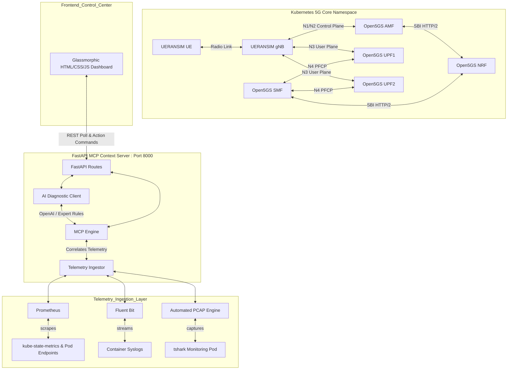

# 📡 MCP-Based Intelligent Interface Monitoring and Failure Detection in Wireless Networks


An integrated, production-grade intelligent monitoring, failure detection, and automated root cause analysis system for a 5G Core Network (5GC) built with **Open5GS** and **UERANSIM** running on **Kubernetes**.

This platform ingests multi-modal telemetry (Prometheus metrics, Fluent Bit syslog streams, and tshark-based packet captures), correlates anomalies into structured **Model Context Protocol (MCP)** payloads, diagnoses network issues using an **AI reasoning engine**, and visualizes state changes in a **glassmorphic operational dashboard**.

---

## 🏗️ Architecture Overview



---

## 📂 Folder Structure

```text
/home/vboxuser/Documents/WMN/
├── k8s/                         # Kubernetes Deployment Manifests
│   ├── open5gs/                 # Open5GS NFs (AMF, UPF, SMF, NRF, PCF, UDM, UDR)
│   ├── ueransim/                # UERANSIM RAN Nodes (gNB, UE)
│   └── monitoring/              # Telemetry (Prometheus, Grafana, Fluent Bit)
├── scripts/
│   ├── failures/                # Disruption & Restoration Scenarios
│   │   ├── amf/                 # AMF Control Plane Crashes
│   │   ├── upf/                 # UPF User Plane Scaling Issues
│   │   ├── network/             # Netem Packet Latency & Loss
│   │   ├── n4/                  # N4 Interface Port Blockades
│   │   ├── nrf/                 # NRF Service Outages
│   │   └── chaos_menu.sh        # Interactive CLI Control Panel
│   └── packet_capture/          # Automated Tshark Capture Scripts
├── backend/                     # FastAPI MCP Context Engine
│   ├── src/
│   │   ├── main.py              # Server entrypoint and control routes
│   │   ├── telemetry.py         # Prom, logs, and capture files ingestor
│   │   ├── mcp.py               # MCP telemetry correlation logic
│   │   └── ai.py                # AI RCA / rule-based diagnostic client
│   ├── requirements.txt         # Python package dependencies
│   └── venv/                    # Virtual Environment
└── frontend/
    └── static/                  # Glassmorphic Web Dashboard HTML/CSS/JS
```

---

## 🚀 Quickstart Guide

### 1. Launch the Backend Server
Initialize the Python virtual environment and launch the FastAPI server:
```bash
cd /home/vboxuser/Documents/WMN
backend/venv/bin/uvicorn backend.src.main:app --host 0.0.0.0 --port 8000 --reload
```

### 2. Open the Control Center
Navigate to the root URL on your host VM or browser:
```
http://localhost:8000/
```

---

## 💥 Supported Disruption & Recovery Scenarios

The dashboard provides single-click controls to inject and recover from the following network failures:

| Scenario / Failure Mode | Target Interface | Injection Mechanism | Severity | AI Mitigation Recommendation |
| :--- | :--- | :--- | :--- | :--- |
| **AMF Control Plane Failure** | N1 / N2 (Control) | Non-destructive `iptables DROP` on SCTP Port 38412 | `CRITICAL` | Remove firewall rules inside AMF pod to stabilize SCTP |
| **UPF Deployment Drop** | N3 / N6 (Data) | Non-destructive `iptables DROP` on Data Plane | `CRITICAL` | Clear forwarding firewall rules in UPF containers |
| **Network Path Delay/Loss** | N3 (Data Plane) | Injects 200ms latency / 20% drop via `netem` | `WARNING` | Clear netem qdisc rules from gNB container |
| **N4 PFCP Blockade** | N4 (Control/User) | Non-destructive `iptables DROP` on UDP port 8805 | `CRITICAL` | Remove iptables DROP rules inside UPF container |
| **NRF Repository Failure** | SBI (Discovery) | Scale Deployment to 0 (Simulated node loss) | `CRITICAL` | Scale deployment back to 1 replica to restore SBI registry |

---

## 🔌 API Endpoints

| Method | Endpoint | Description |
| :--- | :--- | :--- |
| **GET** | `/health` | Server status check |
| **GET** | `/telemetry/metrics` | Ingests live Prometheus indicators |
| **GET** | `/telemetry/logs` | Retrieves parsed Fluent Bit syslog feed |
| **GET** | `/telemetry/captures` | Scans tshark packet capture file metadata |
| **GET** | `/mcp/context` | Builds consolidated Model Context Protocol payload |
| **GET** | `/mcp/diagnose` | Performs AI Root Cause Analysis (RCA) |
| **POST** | `/chaos/inject/{scenario}` | Simulates failure mode (amf, upf, network, n4, nrf) |
| **POST** | `/chaos/restore/{scenario}` | Triggers recovery script |
| **POST** | `/chaos/heal` | Performs global restoration across all components |
